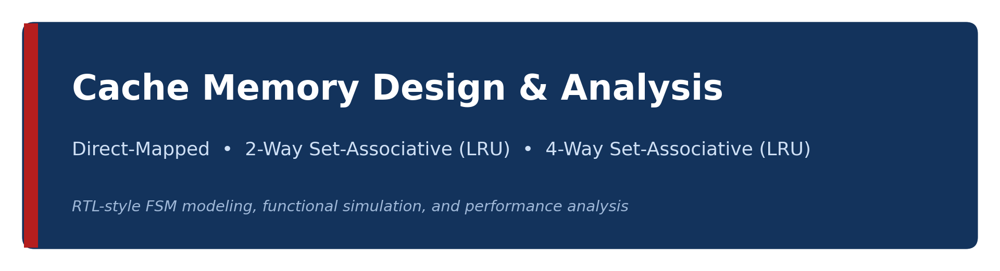
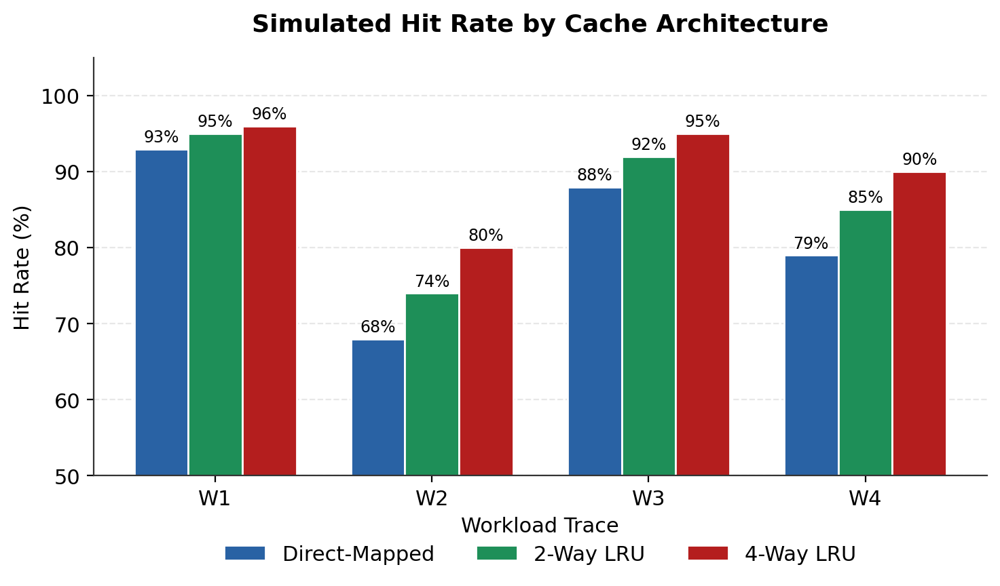
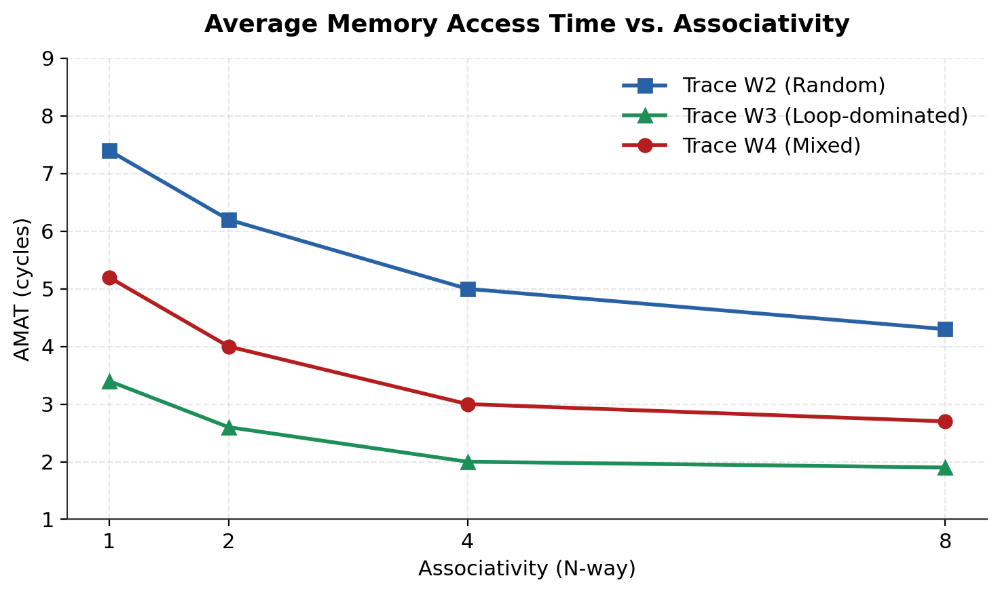
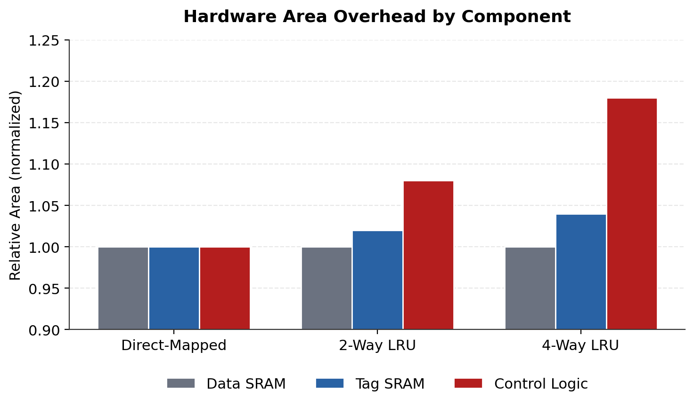

<div align="center">
  

  <br/>

  
  
  
  

</div>

<br/>

## Overview

This repository contains the design, simulation, and performance analysis of three foundational cache memory architectures:

- **Direct-Mapped Cache**
- **2-Way Set-Associative Cache** with LRU replacement
- **4-Way Set-Associative Cache** with Pseudo-LRU (PLRU) replacement

Each design is described structurally and functionally, modeled as a finite-state machine (FSM), simulated against synthetic and mixed workload traces, and evaluated on hit rate, **Average Memory Access Time (AMAT)**, hardware area, and power. The full write-up follows IEEE conference report format and is included in [`docs/`](./docs).

> **Author:** Raham Dil — Department of Computer Engineering, Ghulam Ishaq Khan Institute of Engineering Sciences and Technology (GIKI)

---

## Table of Contents

1. [Background](#background)
2. [Architectures](#architectures)
3. [Replacement Policy: LRU & PLRU](#replacement-policy-lru--plru)
4. [Performance Evaluation](#performance-evaluation)
5. [Hardware Area & Power](#hardware-area--power)
6. [Comparative Summary](#comparative-summary)
7. [Address Decomposition Reference](#address-decomposition-reference)
8. [Repository Structure](#repository-structure)
9. [Getting Started](#getting-started)
10. [References](#references)
11. [License](#license)

---

## Background

Modern processors operate orders of magnitude faster than main memory (DRAM), a gap known as the **memory wall**. Cache memory bridges this gap by exploiting:

- **Temporal locality** — recently accessed data is likely to be reused soon.
- **Spatial locality** — data near a recent access is likely to be accessed shortly after.

A physical address is decomposed into three fields — **Tag**, **Index**, and **Offset** — which together determine where a memory block is placed and how it is identified within the cache:

```
| Tag (A − s − b bits) | Index (s = log2 S bits) | Offset (b = log2 B bits) |
```

where `S` is the number of sets, `B` is the block size, and `N` is the associativity (`S = C / (N × B)`).

Cache misses are classified using the **3C model**: **Compulsory**, **Capacity**, and **Conflict** misses — the last of which is the primary motivation for moving from direct-mapped to set-associative designs.

---

## Architectures

### 1. Direct-Mapped Cache

Each memory block maps to exactly **one** cache line, selected by the index bits. This requires only a single tag comparator and no replacement logic, but is highly susceptible to **thrashing** when two frequently used addresses share the same index.

| Property | Value |
|---|---|
| Comparators per access | 1 |
| Replacement logic | None (direct overwrite) |
| Conflict misses | High |
| Best suited for | IoT / microcontrollers |
 
### 2. 2-Way Set-Associative Cache (LRU)

Each set holds **two** ways. A single LRU bit per set tracks which way was least recently used, halving conflict misses relative to the direct-mapped design at negligible hardware cost.

```
Hit on Way 0  →  LRU bit ← 1   (Way 1 becomes LRU)
Hit on Way 1  →  LRU bit ← 0   (Way 0 becomes LRU)
Miss          →  Evict the way indicated by the LRU bit
```
 
### 3. 4-Way Set-Associative Cache (Pseudo-LRU)

Each set holds **four** ways. True LRU would require `⌈log2(4!)⌉ = 5` bits per set; instead, a **3-bit pseudo-LRU binary tree** is used, which achieves 98–99% of true LRU's hit rate at far lower hardware cost.

<div align="center">

| Bit | Function |
|---|---|
| `b0` | Selects left half (W0/W1) vs. right half (W2/W3) |
| `b1` | Chooses between W0 and W1 |
| `b2` | Chooses between W2 and W3 |

</div>

---
 
## Replacement Policy: LRU & PLRU

| Policy | Bits / Set (N = 4) | Hit-Rate vs. True LRU | Hardware Cost |
|---|---|---|---|
| **True LRU** | 5 | 100% (reference) | High — full permutation tracking |
| **Pseudo-LRU (binary tree)** | 3 | ~98–99% | Low — simple bit-direction logic |

On every access, the path bits toward the accessed way are updated to point *away* from it; the eviction candidate is found by following the bits in the opposite direction.

Each cache line additionally carries a **dirty bit** for the write-back policy — a dirty line must be flushed to lower memory before its slot can be reused.

---

## Performance Evaluation

### Simulation Setup

All designs were evaluated with a **32-bit address space**, a **16 KB L1 cache**, **64-byte blocks**, `t_hit = 1` cycle, and `t_penalty = 20` cycles, against four workload traces:

| Trace | Description | Accesses | Working Set |
|---|---|---|---|
| **W1** | Sequential scan | 100,000 | 12 KB |
| **W2** | Random access | 100,000 | 64 KB |
| **W3** | Loop-dominated | 100,000 | 20 KB |
| **W4** | Mixed (real application) | 200,000 | 48 KB |

### Hit Rate Results

<p align="center">
  
</p>

### Average Memory Access Time (AMAT)

| Architecture | W1 | W2 | W3 | W4 |
|---|---|---|---|---|
| Direct-Mapped | 2.40 | 7.40 | 3.40 | 5.20 |
| 2-Way LRU | 2.00 | 6.20 | 2.60 | 4.00 |
| **4-Way LRU** | **1.80** | **5.00** | **2.00** | **3.00** |

<p align="center">
  
</p>

### 3C Miss-Rate Breakdown (Workload W4)

| Architecture | Compulsory | Capacity | Conflict |
|---|---|---|---|
| Direct-Mapped | 2.1% | 7.4% | **11.5%** |
| 2-Way LRU | 2.1% | 7.4% | **5.5%** |
| 4-Way LRU | 2.1% | 7.4% | **0.5%** |

Compulsory and capacity miss rates stay constant across designs (same working set, same cache size); only **conflict misses** shrink as associativity increases — nearly vanishing at four ways.

---

## Hardware Area & Power

Higher associativity costs area through three mechanisms: extra tag SRAM, wider parallel comparators, and replacement-state storage.

<p align="center">
  
</p>

| Architecture | Data SRAM | Tag SRAM | Control | **Total Area** |
|---|---|---|---|---|
| Direct-Mapped | 1.00× | 1.00× | 1.00× | **1.00×** |
| 2-Way LRU | 1.00× | 1.02× | 1.08× | **1.03×** |
| 4-Way LRU | 1.00× | 1.04× | 1.18× | **1.07×** |

Since data SRAM dominates total area, the four-way design's tag/control overhead translates to only **~7%** more area than the direct-mapped baseline — while cutting conflict misses to near zero.

> **Power note:** parallel tag reads in higher-associativity caches raise per-access dynamic power, but the higher hit rate reduces costly off-chip DRAM accesses, typically yielding **net system-level energy savings** for workloads with moderate-to-high temporal locality.

---

## Comparative Summary

| Criterion | Direct-Mapped | 2-Way LRU | 4-Way LRU |
|---|---|---|---|
| Conflict misses | High | Moderate | Very low |
| Hardware cost | Low | Low–Medium | Medium |
| LRU bits / set | 0 | 1 | 3 (PLRU) |
| Comparators / access | 1 | 2 | 4 |
| Avg. hit rate | ~82% | ~87% | ~90% |
| AMAT (W4, cycles) | 5.20 | 4.00 | **3.00** |
| Area overhead | 1.00× | 1.03× | 1.07× |
| **Best use case** | Embedded / IoT | General purpose | High-performance CPU |

### Design Guidelines

- **Resource-constrained systems** (IoT, microcontrollers) → **Direct-mapped** minimizes area and power.
- **General-purpose embedded processors** → **2-way LRU** offers the best cost/performance balance.
- **High-performance application processors** → **4-way PLRU** is justified by AMAT gains for a small area cost.
- Always profile your target workload — relative gains vary significantly by access pattern.

---

## Address Decomposition Reference

*(32-bit address, 16 KB cache, 64-byte block; offset = 6 bits in all cases)*

| Architecture | N | Sets | Index Bits | Tag Bits |
|---|---|---|---|---|
| Direct-Mapped | 1 | 256 | 8 | 18 |
| 2-Way LRU | 2 | 128 | 7 | 19 |
| 4-Way LRU | 4 | 64 | 6 | 20 |

---

## Repository Structure

```
.
├── assets/                 # Diagrams and charts used in this README
│   ├── banner.png
│   ├── hit_rate_chart.png
│   ├── amat_chart.png
│   └── area_chart.png
├── docs/
│   └── cache_design_report.pdf   # Full IEEE-format report
├── rtl/                    # Hardware description source (Verilog/VHDL)
├── sim/                    # Testbenches and workload traces (W1–W4)
└── README.md
```

---

## Getting Started

```bash
# Clone the repository
git clone https://github.com/<your-username>/cache-memory-design.git
cd cache-memory-design

# Run functional simulations (example using a Verilog simulator)
cd sim
make direct_mapped
make two_way_lru
make four_way_plru
```

> Adjust the commands above to match the actual simulation toolchain used in `sim/` (e.g., Icarus Verilog, ModelSim, or Verilator).

---

## References

1. J. L. Hennessy and D. A. Patterson, *Computer Architecture: A Quantitative Approach*, 6th ed. Morgan Kaufmann, 2019.
2. D. A. Patterson and J. L. Hennessy, *Computer Organization and Design: The Hardware/Software Interface*, 5th ed. Morgan Kaufmann, 2014.
3. A. J. Smith, "Cache memories," *ACM Comput. Surv.*, vol. 14, no. 3, pp. 473–530, Sep. 1982.
4. L. A. Belady, "A study of replacement algorithms for a virtual-storage computer," *IBM Syst. J.*, vol. 5, no. 2, pp. 78–101, 1966.
5. S. A. Przybylski, *Cache and Memory Hierarchy Design: A Performance Directed Approach*. Morgan Kaufmann, 1990.
6. H. Al-Zoubi, A. Milenkovic, and M. Milenkovic, "Performance evaluation of cache replacement policies for the SPEC CPU2000 benchmark suite," in *Proc. 42nd Annu. ACM Southeast Reg. Conf.*, 2004, pp. 267–272.
7. A. Seznec, "A case for two-way skewed-associative caches," in *Proc. 20th Annu. Int. Symp. Comput. Archit. (ISCA)*, 1993, pp. 169–178.
8. S. J. E. Wilton and N. P. Jouppi, "CACTI: An enhanced cache access and cycle time model," *IEEE J. Solid-State Circuits*, vol. 31, no. 5, pp. 677–688, May 1996.

Full citations and the complete formal analysis are available in the [project report](./docs/cache_design_report.pdf).

---

## License

This project is released under the [MIT License](./LICENSE).

<div align="center">
  <sub>Built with ❤️ for Computer Architecture · GIKI, Department of Computer Engineering</sub>
</div>
